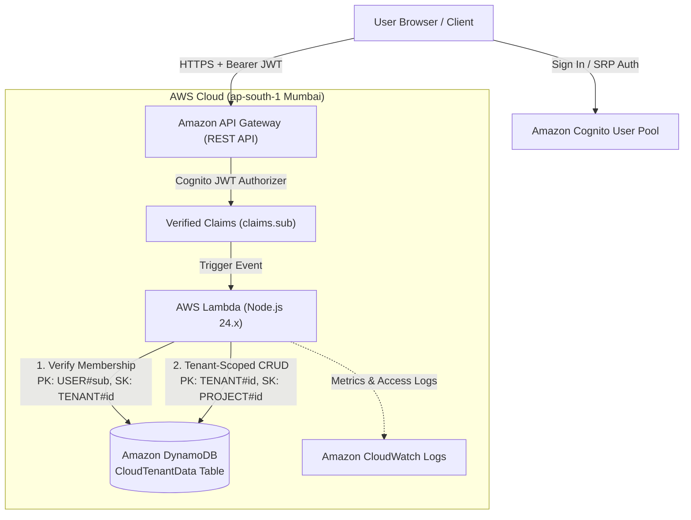

# CloudTenant — Multi-Tenant SaaS Management Platform

> **College Cloud Computing Project**  
> **Target Region:** AWS Asia Pacific (Mumbai) `ap-south-1`  
> **Architecture:** Serverless Multi-Tenant Single-Table Architecture  

---

## 1. System Architecture



---

## 2. Technology Stack

| Layer | Service / Technology | Details |
| :--- | :--- | :--- |
| **Frontend** | React 19 + Vite | Fast responsive SaaS portal with real-time stats, filters, and modal dialogs |
| **Authentication** | Amazon Cognito User Pool | Secure SRP & USER_PASSWORD_AUTH with JWT Authorizer verification |
| **API Layer** | Amazon API Gateway | REST API with JWT Authorizers and CORS headers |
| **Compute** | AWS Lambda | **Node.js 24.x** microservices runtime |
| **Database** | Amazon DynamoDB | Single-Table design with strict partition key tenant isolation |
| **IaC Framework**| AWS SAM / CloudFormation | Declarative infrastructure as code (`template.yaml`) |
| **Region** | `ap-south-1` | Asia Pacific (Mumbai) |

---

## 3. Strict Multi-Tenant Data Isolation Model

### DynamoDB Single-Table Schema

All data resides in a single, cost-effective on-demand DynamoDB table (`CloudTenantData`) using composite primary keys:

| Entity | Partition Key (`PK`) | Sort Key (`SK`) | Description |
| :--- | :--- | :--- | :--- |
| **User Membership** | `USER#<cognito_sub>` | `TENANT#<tenantId>` | Determines which tenants a user is authorized to access, with their role (`Owner`, `Member`). |
| **Tenant Member** | `TENANT#<tenantId>` | `USER#<cognito_sub>` | Reverse index for listing authorized members of a tenant. |
| **Tenant Metadata** | `TENANT#<tenantId>` | `METADATA` | Organization name, subscription plan, owner ID, creation timestamp. |
| **Tenant Project** | `TENANT#<tenantId>` | `PROJECT#<projectId>` | Project details, status, priority, budget, creator information. |

### Security Guarantees
1. **Zero Client Trust:** The backend never trusts a `tenantId` passed in the URL or payload as proof of authorization.
2. **Server-Side Membership Verification:** Every incoming request extracts the caller's immutable user ID from verified Cognito claims (`claims.sub`). The Lambda handler queries `PK = USER#<sub/userId>`, `SK = TENANT#<tenantId>`. If no record exists, the request is immediately rejected with `403 Forbidden`.
3. **Partition-Level Boundary:** All project queries strictly require `PK = TENANT#<tenantId>` and `SK begins_with PROJECT#`. Data belonging to Tenant B is physically impossible to retrieve under Tenant A's partition key.

---

## 4. How to Run Locally

### A. Frontend (React + Vite)
```powershell
cd c:\Users\admin\cloudtenant\frontend
npm run dev
```
Open your browser at `http://localhost:5173/`.  
*Tip:* You can use the **Quick College Demo Login** buttons on the sign-in screen to instantly switch between **Tenant A (Acme Corp)** and **Tenant B (Beta Labs)** to demonstrate isolation without needing live cloud credentials!

### B. Backend Automated Isolation Tests (Mocha / Chai)
Run the 13-test security and multi-tenant test suite:
```powershell
cd c:\Users\admin\cloudtenant\backend\cloudtenant-api-node\hello-world
npm test
```
*Expected Result:*
```text
  CloudTenant API & Multi-Tenant Isolation Tests
    1. Health Check & Public Endpoints
      ✓ returns 200 OK on /health without authentication
      ✓ handles OPTIONS preflight with 200 and CORS headers
    2. Authentication & Authorization Enforcement
      ✓ rejects unauthenticated requests without Cognito claims with 401 Unauthorized
    3. Tenant Creation & Listing
      ✓ allows an authenticated user to create a tenant and become Owner
      ✓ rejects tenant creation with empty name
      ✓ lists only tenants that the authenticated user belongs to
    4. Project CRUD within Authorized Tenant
      ✓ creates, reads, updates, and deletes projects within authorized tenant
    5. STRICT MULTI-TENANT ISOLATION (Cross-Tenant Attack Prevention)
      ✓ DENIES cross-tenant project list attempt with 403 Forbidden
      ✓ DENIES cross-tenant single project read with 403 Forbidden
      ✓ DENIES cross-tenant project creation attempt with 403 Forbidden
      ✓ DENIES cross-tenant project modification with 403 Forbidden
      ✓ DENIES cross-tenant project deletion with 403 Forbidden
      ✓ DENIES cross-tenant member addition with 403 Forbidden

  13 passing (26ms)
```

---

## 5. How to Deploy to AWS (Asia Pacific Mumbai, ap-south-1)

When you are ready to deploy to your AWS account, follow these simple steps:

### Step 1: Configure AWS CLI
Run:
```powershell
aws configure
```
Enter your AWS Access Key ID, Secret Access Key, and default region `ap-south-1`.

### Step 2: Build and Deploy Backend with SAM
In the backend folder:
```powershell
cd c:\Users\admin\cloudtenant\backend\cloudtenant-api-node
sam build
sam deploy --guided
```
SAM will ask for:
- **Stack Name:** `cloudtenant-backend`
- **AWS Region:** `ap-south-1`
- **Confirm changes before deploy:** `Y`
- **Allow SAM CLI IAM role creation:** `Y`
- **Disable rollback on failure:** `N`

Once CloudFormation finishes provisioning, SAM outputs:
```text
Outputs:
ApiBaseUrl         = https://<api-id>.execute-api.ap-south-1.amazonaws.com/Prod
UserPoolId         = ap-south-1_xxxxxxxxx
UserPoolClientId   = xxxxxxxxxxxxxxxxxxxxxxxxxx
DynamoDBTableName  = CloudTenantData
Region             = ap-south-1
```

### Step 3: Link Frontend to Deployed Cloud Stack
Copy the outputs into `frontend/.env`:
```env
VITE_AWS_REGION=ap-south-1
VITE_API_BASE_URL=https://<api-id>.execute-api.ap-south-1.amazonaws.com/Prod
VITE_USER_POOL_ID=ap-south-1_xxxxxxxxx
VITE_USER_POOL_CLIENT_ID=xxxxxxxxxxxxxxxxxxxxxxxxxx
VITE_ENABLE_MOCK_FALLBACK=true
```

Then launch the frontend:
```powershell
cd c:\Users\admin\cloudtenant\frontend
npm run dev
```
The React frontend is now fully connected to your live AWS cloud backend in Mumbai!

---

## 6. Viva & College Evaluation Guide

### Q1: What makes this architecture multi-tenant?
**Answer:** Instead of deploying separate databases and Lambda functions for each customer (silo model), CloudTenant uses a **pool model** where multiple tenants share the same serverless compute and database infrastructure while maintaining strict logical data isolation through composite partition keys.

### Q2: How is data isolation enforced in DynamoDB?
**Answer:** Through DynamoDB's single-table design. Each project item is keyed with `PK: TENANT#<tenantId>` and `SK: PROJECT#<projectId>`. All database reads and writes use this partition key. Because DynamoDB cannot query across partition keys without a full table scan, cross-tenant data leakage is structurally prevented.

### Q3: How is a cross-tenant attack prevented if an attacker crafts a fake request?
**Answer:** The frontend does not determine authorization. The API Gateway authenticates the user's Cognito JWT token and passes verified identity claims (`claims.sub`) to the Lambda function. The Lambda queries the user's membership table (`USER#<sub/userId> / TENANT#<tenantId>`). If the caller is not an authorized member, the backend immediately returns `403 Forbidden` and aborts before any DynamoDB query is performed.
