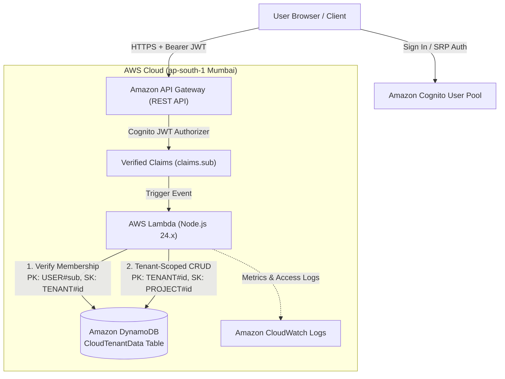

# CloudTenant — Multi-Tenant SaaS Management Platform

> **College Cloud Computing Project**  
> **Target Region:** AWS Asia Pacific (Mumbai) `ap-south-1`  
> **Architecture:** Serverless Multi-Tenant Single-Table Architecture  

---

## 1. System Architecture



---

## 2. Technology Stack

| Layer | Service / Technology | Details |
| :--- | :--- | :--- |
| **Frontend** | React 19 + Vite | Fast responsive SaaS portal with real-time stats, filters, and modal dialogs |
| **Authentication** | Amazon Cognito User Pool | Secure SRP & USER_PASSWORD_AUTH with JWT Authorizer verification |
| **API Layer** | Amazon API Gateway | REST API with JWT Authorizers and CORS headers |
| **Compute** | AWS Lambda | **Node.js 24.x** microservices runtime |
| **Database** | Amazon DynamoDB | Single-Table design with strict partition key tenant isolation |
| **IaC Framework**| AWS SAM / CloudFormation | Declarative infrastructure as code (`template.yaml`) |
| **Region** | `ap-south-1` | Asia Pacific (Mumbai) |

---

## 3. Strict Multi-Tenant Data Isolation Model

### DynamoDB Single-Table Schema

All data resides in a single, cost-effective on-demand DynamoDB table (`CloudTenantData`) using composite primary keys:

| Entity | Partition Key (`PK`) | Sort Key (`SK`) | Description |
| :--- | :--- | :--- | :--- |
| **User Membership** | `USER#<cognito_sub>` | `TENANT#<tenantId>` | Determines which tenants a user is authorized to access, with their role (`Owner`, `Member`). |
| **Tenant Member** | `TENANT#<tenantId>` | `USER#<cognito_sub>` | Reverse index for listing authorized members of a tenant. |
| **Tenant Metadata** | `TENANT#<tenantId>` | `METADATA` | Organization name, subscription plan, owner ID, creation timestamp. |
| **Tenant Project** | `TENANT#<tenantId>` | `PROJECT#<projectId>` | Project details, status, priority, budget, creator information. |

### Security Guarantees
1. **Zero Client Trust:** The backend never trusts a `tenantId` passed in the URL or payload as proof of authorization.
2. **Server-Side Membership Verification:** Every incoming request extracts the caller's immutable user ID from verified Cognito claims (`claims.sub`). The Lambda handler queries `PK = USER#<sub/userId>`, `SK = TENANT#<tenantId>`. If no record exists, the request is immediately rejected with `403 Forbidden`.
3. **Partition-Level Boundary:** All project queries strictly require `PK = TENANT#<tenantId>` and `SK begins_with PROJECT#`. Data belonging to Tenant B is physically impossible to retrieve under Tenant A's partition key.

---

## 4. How to Run Locally

### A. Frontend (React + Vite)
```powershell
cd c:\Users\admin\cloudtenant\frontend
npm run dev
```
Open your browser at `http://localhost:5173/`.  
*Tip:* You can use the **Quick College Demo Login** buttons on the sign-in screen to instantly switch between **Tenant A (Acme Corp)** and **Tenant B (Beta Labs)** to demonstrate isolation without needing live cloud credentials!

### B. Backend Automated Isolation Tests (Mocha / Chai)
Run the 13-test security and multi-tenant test suite:
```powershell
cd c:\Users\admin\cloudtenant\backend\cloudtenant-api-node\hello-world
npm test
```
*Expected Result:*
```text
  CloudTenant API & Multi-Tenant Isolation Tests
    1. Health Check & Public Endpoints
      ✓ returns 200 OK on /health without authentication
      ✓ handles OPTIONS preflight with 200 and CORS headers
    2. Authentication & Authorization Enforcement
      ✓ rejects unauthenticated requests without Cognito claims with 401 Unauthorized
    3. Tenant Creation & Listing
      ✓ allows an authenticated user to create a tenant and become Owner
      ✓ rejects tenant creation with empty name
      ✓ lists only tenants that the authenticated user belongs to
    4. Project CRUD within Authorized Tenant
      ✓ creates, reads, updates, and deletes projects within authorized tenant
    5. STRICT MULTI-TENANT ISOLATION (Cross-Tenant Attack Prevention)
      ✓ DENIES cross-tenant project list attempt with 403 Forbidden
      ✓ DENIES cross-tenant single project read with 403 Forbidden
      ✓ DENIES cross-tenant project creation attempt with 403 Forbidden
      ✓ DENIES cross-tenant project modification with 403 Forbidden
      ✓ DENIES cross-tenant project deletion with 403 Forbidden
      ✓ DENIES cross-tenant member addition with 403 Forbidden

  13 passing (26ms)
```

---

## 5. How to Deploy to AWS (Asia Pacific Mumbai, ap-south-1)

When you are ready to deploy to your AWS account, follow these simple steps:

### Step 1: Configure AWS CLI
Run:
```powershell
aws configure
```
Enter your AWS Access Key ID, Secret Access Key, and default region `ap-south-1`.

### Step 2: Build and Deploy Backend with SAM
In the backend folder:
```powershell
cd c:\Users\admin\cloudtenant\backend\cloudtenant-api-node
sam build
sam deploy --guided
```
SAM will ask for:
- **Stack Name:** `cloudtenant-backend`
- **AWS Region:** `ap-south-1`
- **Confirm changes before deploy:** `Y`
- **Allow SAM CLI IAM role creation:** `Y`
- **Disable rollback on failure:** `N`

Once CloudFormation finishes provisioning, SAM outputs:
```text
Outputs:
ApiBaseUrl         = https://<api-id>.execute-api.ap-south-1.amazonaws.com/Prod
UserPoolId         = ap-south-1_xxxxxxxxx
UserPoolClientId   = xxxxxxxxxxxxxxxxxxxxxxxxxx
DynamoDBTableName  = CloudTenantData
Region             = ap-south-1
```

### Step 3: Link Frontend to Deployed Cloud Stack
Copy the outputs into `frontend/.env`:
```env
VITE_AWS_REGION=ap-south-1
VITE_API_BASE_URL=https://<api-id>.execute-api.ap-south-1.amazonaws.com/Prod
VITE_USER_POOL_ID=ap-south-1_xxxxxxxxx
VITE_USER_POOL_CLIENT_ID=xxxxxxxxxxxxxxxxxxxxxxxxxx
VITE_ENABLE_MOCK_FALLBACK=true
```

Then launch the frontend:
```powershell
cd c:\Users\admin\cloudtenant\frontend
npm run dev
```
The React frontend is now fully connected to your live AWS cloud backend in Mumbai!

---

## 6. Viva & College Evaluation Guide

### Q1: What makes this architecture multi-tenant?
**Answer:** Instead of deploying separate databases and Lambda functions for each customer (silo model), CloudTenant uses a **pool model** where multiple tenants share the same serverless compute and database infrastructure while maintaining strict logical data isolation through composite partition keys.

### Q2: How is data isolation enforced in DynamoDB?
**Answer:** Through DynamoDB's single-table design. Each project item is keyed with `PK: TENANT#<tenantId>` and `SK: PROJECT#<projectId>`. All database reads and writes use this partition key. Because DynamoDB cannot query across partition keys without a full table scan, cross-tenant data leakage is structurally prevented.

### Q3: How is a cross-tenant attack prevented if an attacker crafts a fake request?
**Answer:** The frontend does not determine authorization. The API Gateway authenticates the user's Cognito JWT token and passes verified identity claims (`claims.sub`) to the Lambda function. The Lambda queries the user's membership table (`USER#<sub/userId> / TENANT#<tenantId>`). If the caller is not an authorized member, the backend immediately returns `403 Forbidden` and aborts before any DynamoDB query is performed.


--------------------------------------------------------------------------------------------------------------------------------------------------------------------------------------------------------------------------------------------------------------------------------------------------------------------------------------------------------------------------------
28th wednesday updates 
[ USER (Browser) ]
        │
        ▼
1. AWS Amplify (Frontend Web Hosting)
        │
        ▼ (HTTPS Request with Bearer Token)
2. Amazon API Gateway (The Front Door & Traffic Police)
   ├── Authenticates token with 3. Amazon Cognito (Identity & Auth)
   └── Forwards verified request to:
        │
        ▼
4. AWS Lambda — Node.js 24.x (The Brain & Security Enforcement)
        │
        ▼ (Queries tenant-isolated partitions)
5. Amazon DynamoDB (Single-Table Database)
        │
        └── Monitored by 6. Amazon CloudWatch (Logs & Metrics)
1. Amazon API Gateway (The "Front Door & Traffic Police")

  
Real-World Analogy: Like the security guard standing at the entrance of a high-security office building.

  
What It Does in Your Project:
  
  

  
It provides the public HTTPS web link (https://pt85c8cxgh.execute-api.ap-south-1.amazonaws.com/Prod) where your frontend sends requests.

  
Before letting any request reach your code, it automatically verifies the user's Amazon Cognito JWT token. If the token is fake or expired, API Gateway blocks it immediately with 401 Unauthorized.

  
Handles CORS (Cross-Origin Resource Sharing) so your Amplify website can safely talk to the API.

  

  
2. Amazon Cognito (The "Identity & Passport Office")

  
Real-World Analogy: Like the government passport office that issues and verifies your national ID card.

  
What It Does in Your Project:
  
  

  
Stores user credentials (passwords are securely hashed with bcrypt/SHA-256).

  
Automatically handles email verification codes.

  
When a user logs in with the correct password, Cognito creates a cryptographically signed digital ticket called a JWT (JSON Web Token) that proves who the user is.

  

  
3. AWS Lambda — Node.js 24.x (The "Brain / Serverless Engine")

  
Real-World Analogy: Like a smart vending machine. It doesn't run an engine 24/7; it only wakes up when you press a button, serves your request in a split second, and goes back to sleep.

  
What It Does in Your Project:
  
  

  
Executes your backend JavaScript code (app.mjs) on the modern Node.js 24.x runtime.

  
Enforces Multi-Tenant Isolation: It extracts the user's ID from Cognito claims (claims.sub), verifies if the user is a registered member of the requested tenant in DynamoDB, and blocks cross-tenant attacks with 403 Forbidden.

  
Performs all project CRUD operations (Create, Read, Update, Delete).

  

  
4. Amazon DynamoDB (The "High-Speed Vault")

  
Real-World Analogy: Like a giant digital filing cabinet with separate labeled folders for every company.

  
What It Does in Your Project:
  
  

  
A fully managed, NoSQL database with lightning-fast millisecond response times.

  
Single-Table Architecture: We store all companies in one table (CloudTenantData) using composite keys:
  
  

  
PK: TENANT#org-acme (Acme's projects folder)

  
PK: TENANT#org-stark (Stark's projects folder)

  
PK: USER#alex (Alex's organization memberships)

  

  
Because DynamoDB strictly queries by Partition Key (PK), Tenant A physically cannot query Tenant B's folder.

  

  
5. AWS Amplify Hosting (The "Global Billboard")

  
Real-World Analogy: Like a web hosting company that puts your website on the internet for the public.

  
What It Does in Your Project:
  
  

  
Takes your React frontend and hosts it on AWS's global Content Delivery Network (CDN) at main.d3tukq2e2p1vgm.amplifyapp.com.

  
Connected to your GitHub repository: whenever you run git push, Amplify automatically builds and updates the live website.

  

  
6. AWS SAM & CloudFormation (The "Architect & Robot Builder")

  
Real-World Analogy: Like a 3D architectural blueprint that automatically builds the real building at the press of a button.

  
What It Does in Your Project:
  
  

  
Known as Infrastructure as Code (IaC).

  
Instead of clicking 50 buttons in the AWS console, our template.yaml file defines the DynamoDB table, API Gateway, Lambda, and Cognito in code.

  
Running sam deploy tells AWS CloudFormation to automatically create all those services in Mumbai in under 2 minutes.

  

  
7. Amazon CloudWatch (The "Black Box Flight Recorder")

  
Real-World Analogy: Like security CCTV cameras recording every entry and exit.

  
What It Does in Your Project:
  
  

  
Automatically records all Lambda execution logs, error messages, and API Gateway traffic.

  
If someone tries to hack the system, CloudWatch records the error and timestamp for audit purposes.

  

  
8. React 19 + Vite (The "Cockpit / Dashboard UI")

  
What It Does in Your Project:
  
  

  
The frontend user interface running in the browser.

  
Provides responsive project cards, status pills, budget metrics, search filters, and the 🛡️ Isolation Inspector viva evaluation tool.

  

  
Summary Checklist for Your Viva:
Service	Category	Function in Project
AWS Amplify	Hosting	Hosts the React frontend on the public internet
API Gateway	Networking / API	REST endpoints, CORS headers, token verification
Cognito	Security / Auth	User directory, authentication, JWT tokens
Lambda (Node.js 24.x)	Serverless Compute	Business logic & multi-tenant security verification
DynamoDB	Database (NoSQL)	Single-table storage with partition key tenant isolation
CloudWatch	Monitoring	Ingests server logs, errors, and access metrics
AWS SAM	DevOps / IaC	Deploys all cloud infrastructure via code
AWS Region	Data Center	ap-south-1 (Mumbai, India) for low latency
how can i acess the admin view here, all i can see myself doing is access the tenant view 
no dont do anything, just tell me how can i access the admin view

In a real cloud multi-tenant platform, the Platform Admin (You) does not manage the entire system through the customer website.

Instead, your Admin Console is directly inside the AWS Management Console:

1. To View All Tenants & All Projects (The Master Database View)

  
Go to the AWS Console (console.aws.amazon.com).

  
Make sure your region in the top right is set to Asia Pacific (Mumbai) ap-south-1.

  
In the top search bar, search for DynamoDB.

  
In the left menu, click Tables → click CloudTenantData.

  
Click the orange button: "Explore table items".
  
  

  
What you see: You will see every tenant, every user, and every project across the entire platform listed here, partitioned by PK: TENANT#... and PK: USER#....

  

  
2. To View All Registered Users (The Identity View)

  
In the AWS search bar, type Cognito.

  
Click User Pools → select your pool: cloudtenant-api-node-user-pool.

  
Click the Users tab.
  
  

  
What you see: A complete directory of all registered user accounts, their verification status, and their unique Cognito IDs (sub).

  

  
3. To View System Health & Live Traffic (The Monitoring View)

  
In the AWS search bar, type CloudWatch.

  
In the left menu, click Log groups → click /aws/lambda/cloudtenant-api-node-....
  
  

  
What you see: Live logs of every API call, execution times, and any blocked cross-tenant attempts.

  

  
4. Inside the Website (The Technical Evaluation View)

In the website itself, click the "🛡️ Isolation Inspector" button in the top navigation bar:


  
It shows the architectural partition model.

  
It displays your active AWS stack specifications (Mumbai region, Lambda, DynamoDB, Cognito).

  
It provides the live cross-tenant attack simulator to prove security to your examiner.